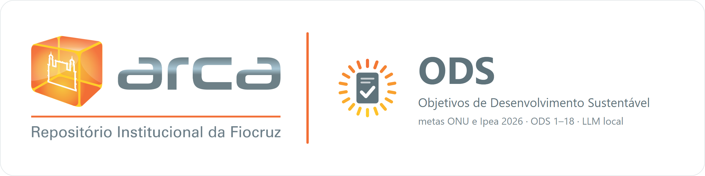
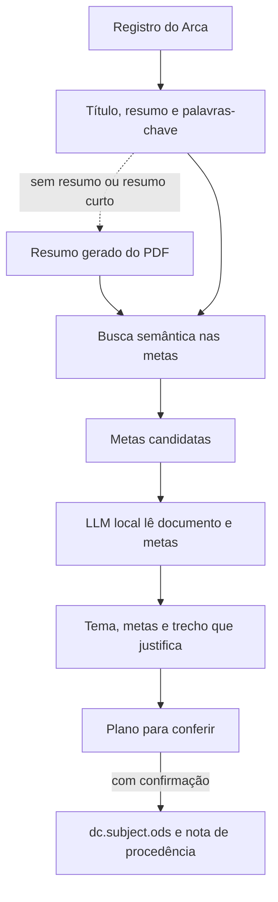

<p align="center">
  
</p>

<p align="center">
  
  
  
  
  
</p>

<p align="center">
  Indexação dos <b>Objetivos de Desenvolvimento Sustentável (ODS)</b> nos registros do <b>Arca</b>,
  o repositório institucional da Fiocruz, usando o texto oficial das metas e modelos de linguagem locais.
</p>

<p align="center"><a href="#english">English summary</a> · <a href="https://github.com/XbelchiorX/Arca-DeCS">Arca DeCS, o projeto irmão</a></p>

## O que é

O Arca ODS lê o título, o resumo e as palavras-chave de um documento e indica a quais metas dos ODS ele se relaciona,
incluindo o **ODS 18 (igualdade étnico-racial)**, próprio do Brasil. A resposta vem no nível da **meta**, com o tema do
documento e o trecho copiado que justifica cada atribuição, para que uma pessoa possa conferir a decisão.

> [!NOTE]
> **Projeto em desenvolvimento.** O método ainda está sendo avaliado, e os resultados serão divulgados em publicação
> própria. Aqui está o código.

## Como funciona



1. **Critério oficial.** O documento é julgado só pelo texto das metas da ONU e da adaptação brasileira do Ipea (2026),
   sem regras próprias por ODS.
2. **Busca semântica.** O Qwen3-Embedding-8B compara o documento com todas as metas e separa as mais próximas.
3. **Decisão por LLM.** Um modelo local (Qwen3.5-35B-A3B, via `llama-server`) lê o documento e as metas candidatas,
   escreve do que o documento trata, escolhe as metas e copia o trecho que justifica a escolha.
4. **Classificador.** Um modelo menor, treinado com os rótulos da LLM, permite processar o acervo inteiro (`arca/ods_modelo.py`).
5. **Gravação com rastro.** Nada é gravado sem confirmação. O valor original fica guardado, e uma nota `[ODS-AUTO]` registra
   data, ODS e método.

## Princípios

- 📜 **Só o texto das metas.** Nenhuma regra por ODS, nenhum exemplo de atribuição.
- 🔍 **Decisão que se confere.** Toda meta vem com o trecho do documento.
- 📏 **Mudou o método? Meça antes.** Toda mudança de prompt ou de modelo é medida em registros reservados.
- 🏠 **Tudo local.** Os modelos rodam na máquina; nenhum texto precisa sair dela.
- 🛡️ **O histórico é intocável.** `dc.description.provenance` nunca é alterado.

## Instalação

Requisitos: Python 3.11 ou mais novo, navegador Brave (login Microsoft do Arca) e GPU NVIDIA para rodar os modelos.

```bash
git clone https://github.com/XbelchiorX/Arca-ODS.git
cd Arca-ODS
python -m pip install -r requirements.txt
```

**O que não vem no repositório:**

| O quê | Como obter |
|---|---|
| Metas do Ipea (`dados/ods_referencia/metas_2026.json`) | `ferramentas/ods/referencia/extrair_metas_2026.py`, a partir do PDF *Nacionalização da Agenda 2030* (Ipea, 2026) |
| Cópia local do acervo | Opção **D4** do menu (só leitura) |
| Modelos | Baixados do Hugging Face na primeira execução; `ODS_NAS_LLM` aponta para uma pasta própria |
| `llama-server` com CUDA | [llama.cpp](https://github.com/ggml-org/llama.cpp); `ODS_LLAMA_SERVER` indica o caminho |

## Uso

```bash
python executar.py
```

Para garantir que nada seja gravado, no PowerShell:

```powershell
$env:ARCA_SOMENTE_LEITURA="sim"; python executar.py
```

| Opção | O que faz |
|---|---|
| **O1** | Um item: mostra o plano e grava se você confirmar |
| **O2** | Uma lista de handles colados ou um `.txt` |
| **O3** | O acervo inteiro, com filtro por data e por ter ou não ODS |
| **O4** | Prepara os sinais (só leitura) |
| **O5** | Treina e avalia o classificador |
| **O6** | Testa o professor em um item |
| **D4** | Atualiza a cópia local do acervo (só leitura) |

### Principais ajustes

| Variável | Para quê |
|---|---|
| `ODS_PROMPT` | Versão do prompt (`8`, `11`, `12`...) |
| `ODS_N_METAS` | Quantas metas candidatas a LLM recebe |
| `ODS_PROFESSOR` | Qual modelo local decide |
| `ARCA_SOMENTE_LEITURA` | `sim` impede qualquer gravação |
| `DSPACE_API` | Endereço da API de outro DSpace |

## Pastas

```
executar.py        abre o menu
arca/ods_*.py      método de ODS (metas, busca, LLM, classificador, gravação)
arca/decs_*.py     módulos compartilhados com o Arca DeCS (leitura do acervo, itens, rastreabilidade)
arca/dspace.py     login e acesso ao DSpace, com as travas de escrita
ferramentas/ods/   rodada do acervo, treino, avaliação e extração das metas
testes/            python -m unittest discover testes  (precisa do XML do DeCS da BIREME)
```

## Dados abertos relacionados

[Embeddings dos metadados do Arca com Qwen3-Embedding-8B](https://doi.org/10.5281/zenodo.23480451), no Zenodo (CC BY 4.0).

## Como citar

Use o botão **Cite this repository** do GitHub ou o arquivo [`CITATION.cff`](CITATION.cff).

## Marca

A marca Arca pertence à Fiocruz e aparece aqui só para identificar o repositório a que este projeto serve.

---

<a id="english"></a>

## English summary

**Arca ODS** assigns **UN Sustainable Development Goals (SDGs)** to records in Arca, the institutional repository of the
Oswaldo Cruz Foundation (Fiocruz, Brazil, DSpace 9.3). It works at **target level**, covers the 17 goals plus Brazil's
**SDG 18 (ethnic and racial equality)**, and judges each document only against the official text of the UN targets and
their Brazilian adaptation (Ipea, 2026), with no per-goal rules.

Semantic search selects the closest targets, a **local LLM** reads the document and those targets, and it returns the
topic, the targets and a verbatim passage justifying each one. Nothing is written without confirmation, and every change
leaves a provenance note. The project is under development, and results will appear in a dedicated publication.

**Keywords:** SDG classification, Sustainable Development Goals, ODS, Agenda 2030, institutional repository, DSpace,
research metadata, local LLM, Qwen, llama.cpp, Portuguese NLP, Fiocruz.
